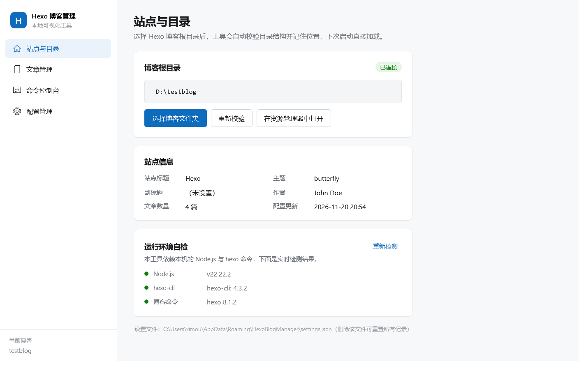
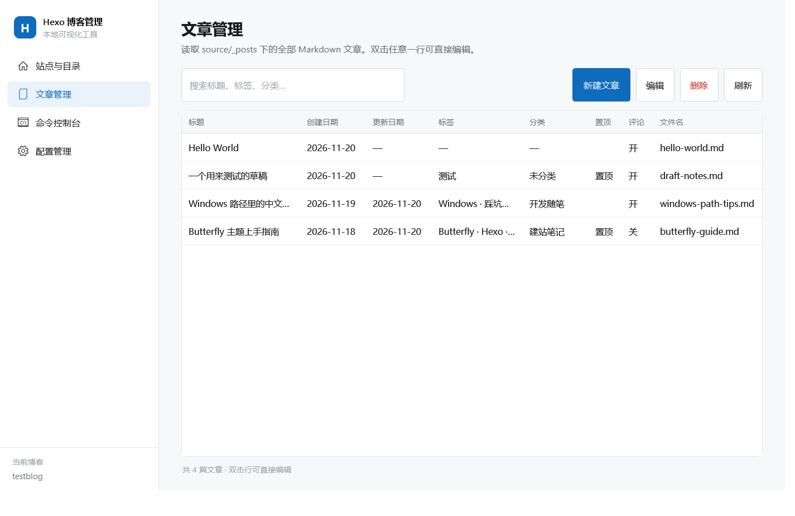
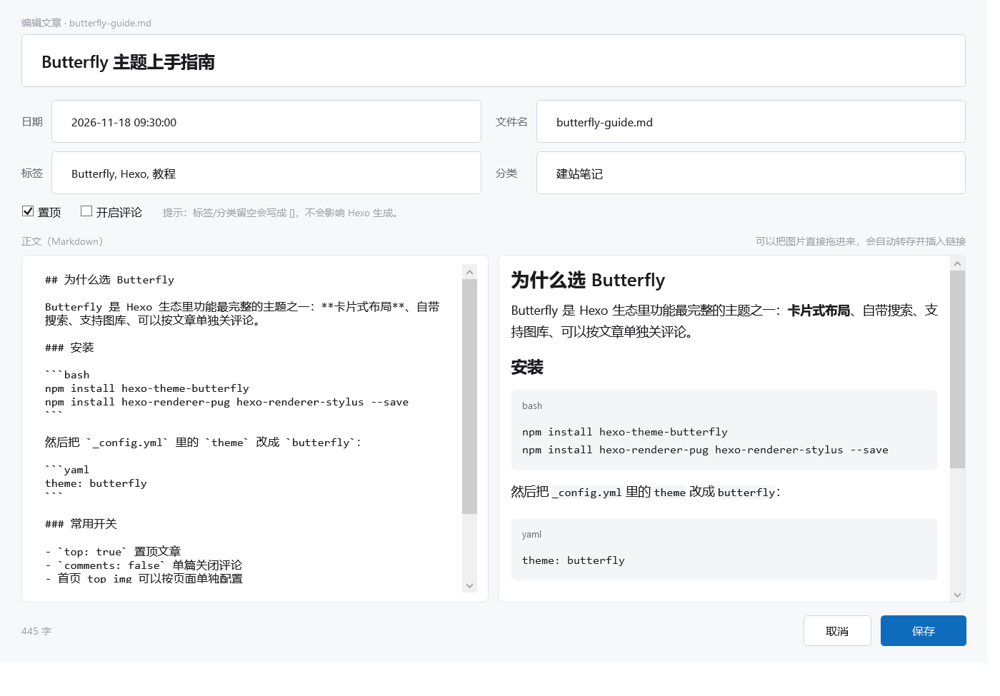
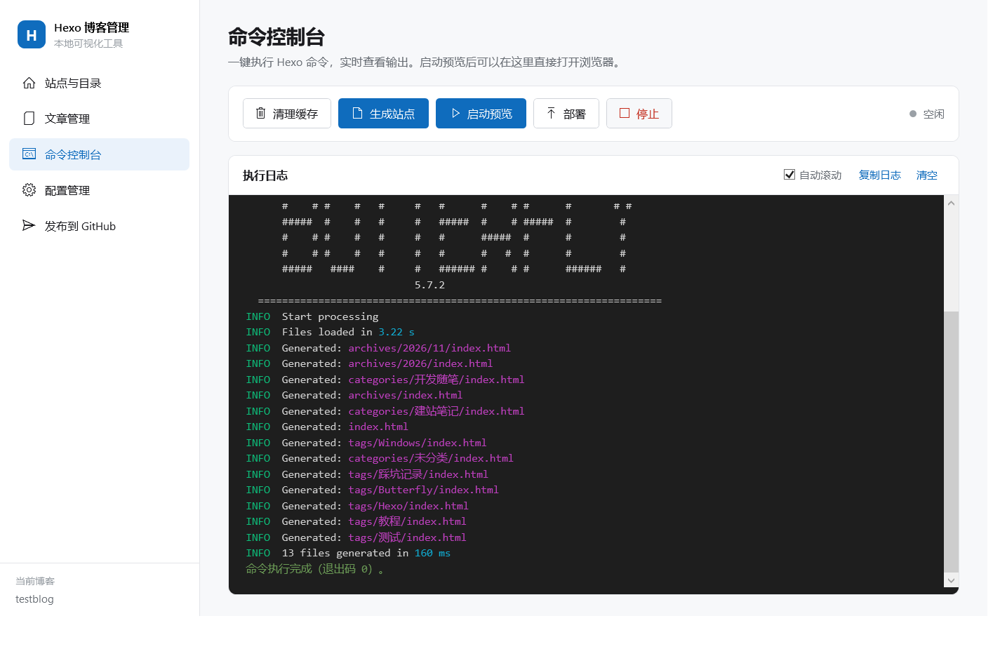
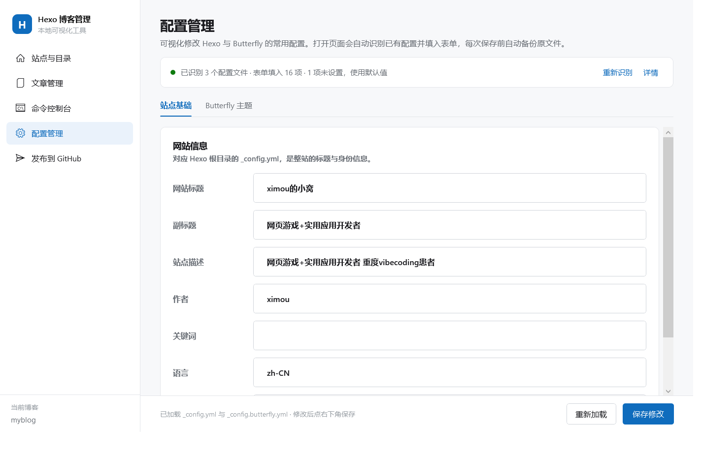
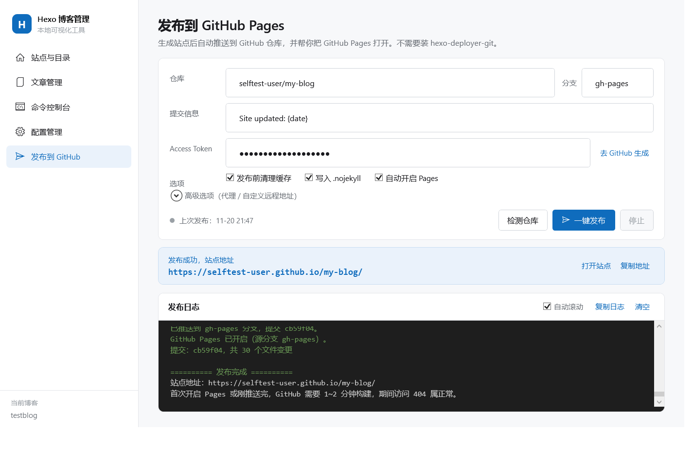

# Hexo 博客本地管理

一个面向 Windows 的 Hexo 博客本地可视化管理工具。不用再敲 `hexo` 命令、不用手动打开编辑器改 front-matter，点点鼠标就能写文章、跑命令、改 Butterfly 配置，一键发布到 GitHub Pages。

基于 **C# WPF / .NET 10**，零第三方 NuGet 依赖（没有 MVVM 框架、没有 YAML 库、没有 Octokit），单文件发布后是一个 exe，双击即用。



## 功能

### 1. 博客目录管理
- 选择 Hexo 博客根目录，自动校验 `_config.yml` 与 `source/_posts` 是否存在
- 记住上次的路径，下次打开自动加载
- 选到 `source` 子目录这类常见错误时，直接告诉你正确的根目录在哪
- 中文路径、带空格路径全部支持（内部统一用 `cmd.exe /c "chcp 65001>nul && 命令"` + Unicode 工作目录）
- 启动自检 Node / hexo-cli / 博客内 hexo 版本

### 2. 文章管理（适配 Butterfly）


- 列表展示标题、创建/更新日期、标签、分类、置顶、评论开关、文件名
- 按标题 / 标签 / 分类 / 文件名搜索
- 新建文章自动生成 Butterfly 规范的 front-matter
- **保存时不破坏你自己加的字段**：内部记住每个键的原始行块，只替换 `title/date/updated/tags/categories/top/comments`，`cover`、`description` 等原样保留
- 兼容四种写法：多行列表、行内 `[a, b]`、单值标量 `categories: 未分类`、数字置顶 `top: 2`
- 左侧编辑、右侧实时预览（自写 Markdown → FlowDocument 渲染器，支持标题、代码块、行内代码、列表、引用、链接、图片）
- 拖拽图片到编辑器，自动转存到 `source/images/yyyy/MM/` 并插入链接
- 删除走 **Windows 回收站**，不是直接抹掉



### 3. Hexo 命令控制台


- 一键 `hexo clean` / `generate` / `server` / `deploy`
- 流式日志 + 彩色分级，并把 Hexo 自带的 ANSI 颜色码还原成真正的颜色
- `hexo server` 自动提取预览地址，点一下就能打开浏览器；「停止」会连 node 子进程一起杀掉，不留僵尸进程
- 命令失败给出针对性中文排查清单
- **能识别「退出码 0 但其实失败了」**：Hexo 在 deployer 缺失时打 ERROR 却仍返回 0，只看退出码会误报成功

### 4. Butterfly 配置管理
- **打开页面自动识别已有配置**：主配置、`_config.production.yml` 之类的环境覆盖配置、主题三处候选位置（根目录覆盖层 / `themes` / `node_modules`）都会找一遍，按 Hexo 的真实优先级合并后填入表单
- 每个字段都能看到「值来自哪个文件第几行」；配置缺失、写坏（Tab 缩进、缺冒号、重复键、引号没闭合）、编码是 GBK 都能读，读不到就用默认值，绝不因为读失败让页面打不开
- 「重新识别」会保留你改过但没保存的内容；从主题默认值继承来的项，保存时不会主动写进你的配置文件
- 可视化编辑 `_config.yml`（站点标题/副标题/描述/作者/关键词/语言/地址）
- 可视化编辑 Butterfly 主题配置（导航菜单逐行编辑、导航栏开关、页脚文字与开关、评论系统）
- 评论系统支持切到 **giscus**，参数（repo / repo_id / category_id）在界面里填，缺失的配置段会自动创建；遇到 Valine / Waline 等其他系统会标成「保持原样」，保存不会把它抹掉
- 采用「点路径 + 行级改写」而不是「解析 → 序列化」，注释、字段顺序、缩进一个字节都不动
- 保存前自动备份为 `_config.yml.yyyyMMdd-HHmmss.bak`，最多保留 10 份



### 5. 一键发布到 GitHub Pages


- 填 `用户名/仓库名`（也支持直接粘仓库 URL 或 SSH 地址）和 Personal Access Token
- 「检测仓库」先验 Token、看仓库存不存在（不存在可以顺手创建）、Pages 开没开
- 「一键发布」：`hexo clean` → `hexo generate` → 同步到 `.deploy_git` → 提交 → 强制推送 → 调 API 打开 Pages → 给出访问地址
- **不需要装 `hexo-deployer-git`**，也不动你的 `_config.yml`
- Token 用 Windows DPAPI（当前用户作用域）加密后存盘，`settings.json` 被拷走也解不开，日志里全部脱敏
- 内容没变化时重复发布不会报错

## 运行要求

| 项目 | 说明 |
|---|---|
| 系统 | Windows 10 / 11（仅 Windows） |
| 运行时 | 发行版是自包含单文件 exe，**不需要装 .NET**；从源码构建需要 .NET 10 SDK |
| Hexo | 本机已装 Node.js 与 hexo-cli（工具直接调用 `hexo` 命令） |
| Git | 使用发布功能需要 Git for Windows |

## 下载使用

到 [Releases](../../releases) 下载 `HexoBlogManager-v1.0.0-win-x64.zip`，解压后双击 `HexoBlogManager.exe`。

首次启动先在「站点与目录」里选择你的 Hexo 博客根目录，其余页面会自动跟上。

## 从源码构建

```bash
git clone https://github.com/tianqi-studio/hexo-blog-manager.git
cd hexo-blog-manager/HexoBlogManager
dotnet run
```

发布单文件版本：

```bash
dotnet publish -c Release -r win-x64 --self-contained true ^
  -p:PublishSingleFile=true -p:EnableCompressionInSingleFile=true ^
  -p:IncludeNativeLibrariesForSelfExtract=true -o publish
```

## 项目结构

```
HexoBlogManager/
├─ Models/            AppSettings、BlogSiteInfo、PostMeta、GitHubPublishSettings
├─ Services/
│   ├─ ProcessRunner.cs        一次性执行命令（UTF-8、超时、杀进程树）
│   ├─ HexoCommandRunner.cs    流式执行 hexo 命令
│   ├─ StreamingProcess.cs     可注入分级规则的流式进程（git 用）
│   ├─ AnsiText.cs             ANSI 转义码 → WPF 颜色
│   ├─ BlogSiteService.cs      目录校验 + 站点信息
│   ├─ PostService.cs          文章扫描 / 新建 / 保存 / 图片转存
│   ├─ FrontMatter.cs          front-matter 解析与保真重建
│   ├─ MarkdownRenderer.cs     Markdown → FlowDocument
│   ├─ RecycleBin.cs           删除到回收站（SHFileOperation）
│   ├─ YamlPathEditor.cs       点路径行级读写 YAML（写入）
│   ├─ YamlFlatReader.cs       容错型 YAML 扁平解析（读取，坏行只警告不中断）
│   ├─ BlogConfigScanner.cs    配置文件自动检测 / 优先级合并 / 字段来源追踪
│   ├─ ConfigService.cs        配置文件定位 / 备份
│   ├─ SecretProtector.cs      DPAPI 加解密 Token
│   ├─ GitHubApi.cs            GitHub REST API（仓库 / Pages）
│   ├─ GitHubPublisher.cs      一键发布主流程
│   └─ SettingsService.cs      %AppData% 持久化
├─ Views/             SiteView、PostsView、PostEditorWindow、ConsoleView、ConfigView、PublishView
└─ Styles/Theme.xaml  全局配色与控件样式
_selftest/            回归测试（链接主项目源文件，不需要 WPF）
```

## 几个关键设计取舍

**为什么发布不用 `hexo-deployer-git`？**
它要改你的 `_config.yml` 还要装 npm 包，配错一步整个博客生成都会报错；出错只有一行 git 报错；而且它不负责「帮你把 Pages 打开」。自己用 git 命令行做，每一步都能打日志、都能给中文提示。

**为什么部署目录是 `.deploy_git` 而不是 `public`？**
踩过坑：把 `.git` 放在 `public` 里，git 的对象文件是只读的，`hexo clean` 想删 `public` 时会报 `ENOENT`，「清理缓存」从此永久失败。换成博客根目录的独立目录后，clean 不受影响，提交历史还是增量的。这个名字也和 `hexo-deployer-git` 保持一致。

**为什么 Token 用 DPAPI？**
`%AppData%` 下的文件任何程序都读得到，明文存等于把仓库写权限送人。DPAPI 的密钥由 Windows 按当前用户托管，程序里不存任何密钥。

**为什么 YAML 用行级改写而不是解析再序列化？**
用户的配置文件里有大量注释、空行、特殊缩进。解析再写回会把这些全部洗掉，改一个标题却毁掉整份配置，这是不可接受的。

## 自检

`_selftest` 是一个控制台工程，直接链接主项目的纯逻辑源文件（不依赖 WPF），覆盖 front-matter 解析与保真重建、YAML 行级编辑、备份、DPAPI 往返、GitHub API（对着本地 mock 服务）、以及真实的 `hexo generate` + git 推送流程。

```bash
cd _selftest
dotnet run
# ===== 合计：通过 176 项，失败 0 项 =====
```

> 自检会用到 `D:\testblog` 这个本地测试博客（Hexo 8 + Butterfly 5.7.2），路径写在 `_selftest/Program.cs` 顶部，可以改成你自己的。

## 已知限制

1. Markdown 预览是「看结构」级别，不渲染表格、数学公式、嵌套 HTML
2. 编辑已有文章不能改文件名（避免站内链接和外部收录失效）
3. 拖入的图片固定进 `source/images/`，没有跟 `post_asset_folder` 联动
4. 发布走分支模式（`gh-pages`），没有生成 GitHub Actions 工作流
5. 自定义域名（CNAME）还没做可视化配置

## 说明

测试站为 Hexo 8.1.2 + Butterfly 5.7.2，界面截图都是程序真实渲染后截的，不是设计稿。

## 许可证

本项目采用 [MIT License](LICENSE) 开源。

你可以自由使用、修改、分发，包括商用，只需保留版权声明与许可声明。软件按「现状」提供，不附带任何担保。

